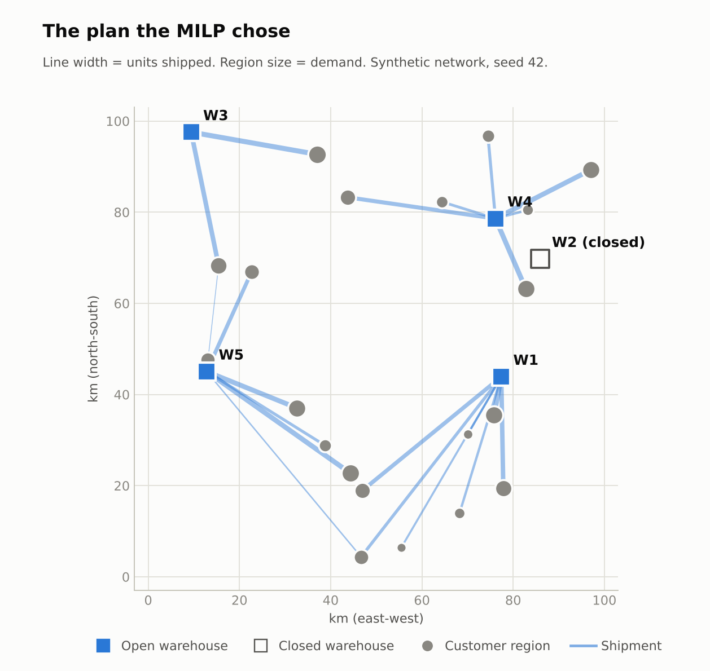
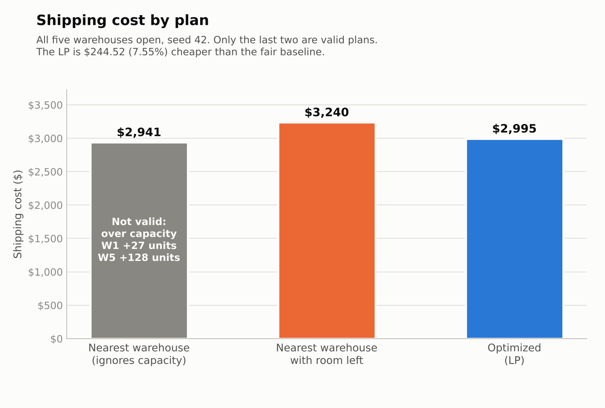
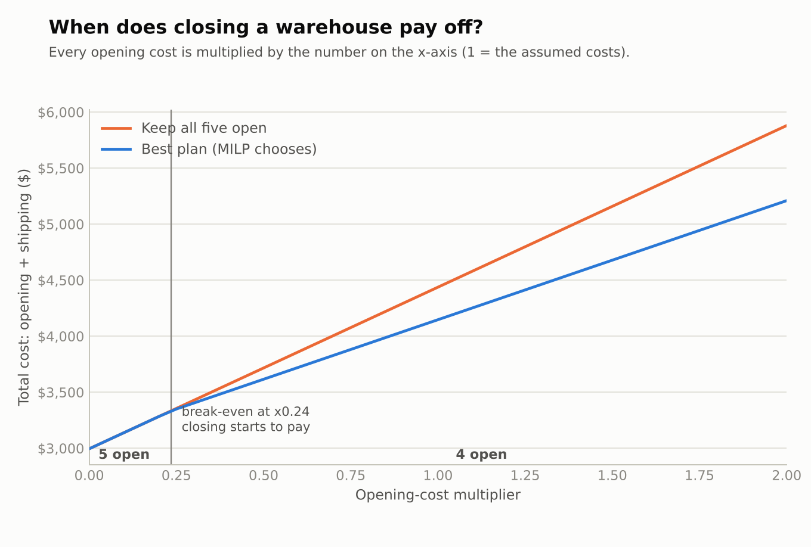
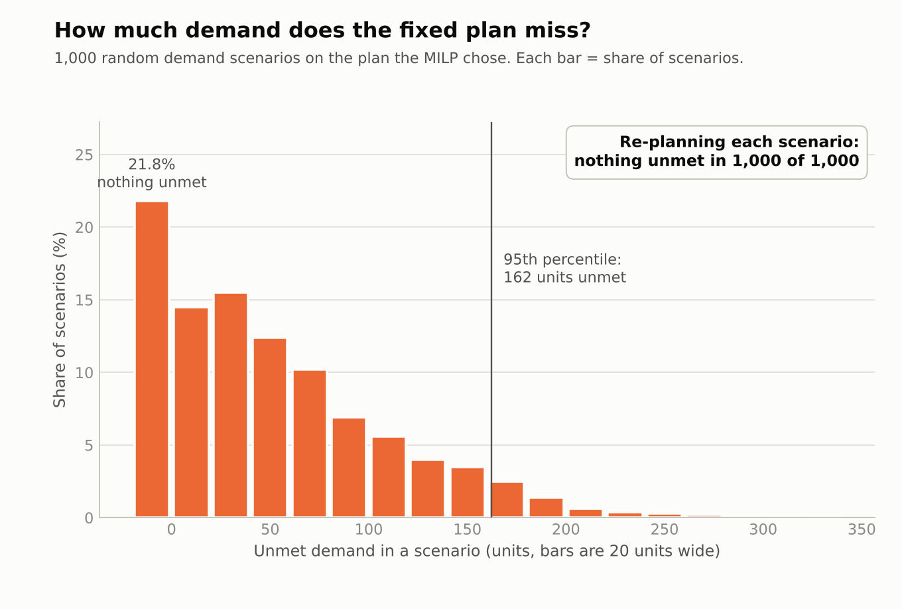
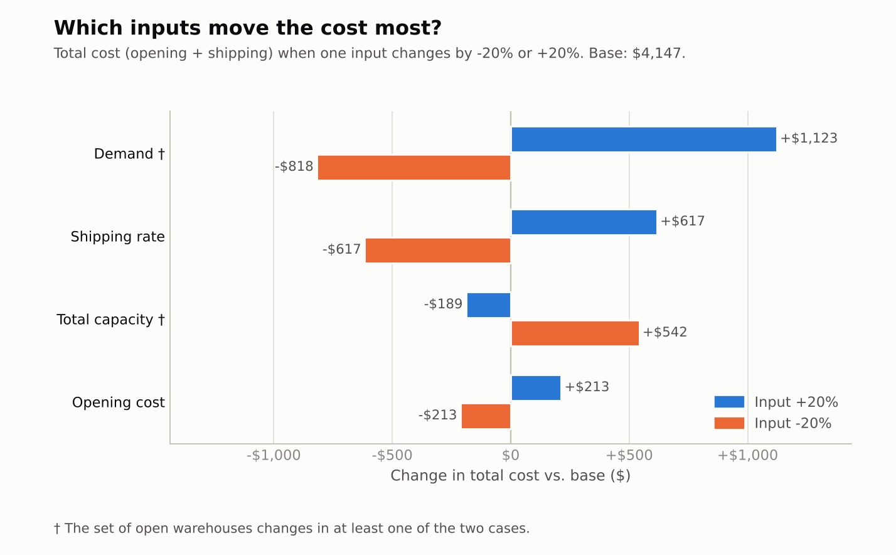
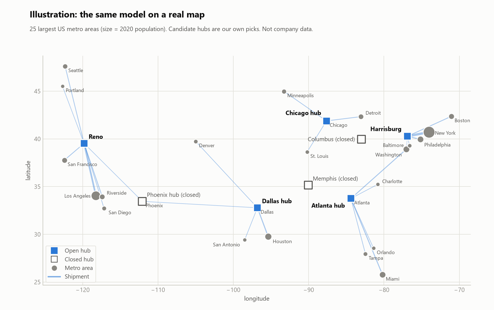

# Supply Chain Optimization Engine

[](https://github.com/nifemifabunmi/supply-chain-optimizer/actions/workflows/tests.yml)

Which warehouses should a company open, and which warehouse should ship to which customer region?
This project answers that with linear and mixed-integer programming, then stress-tests the answer
with simulation.

**All data is synthetic.** Every number below is computed by the code in this repository
(`python run_all.py`), not typed in. The assumptions are listed at the end of the results.

## What it does

| Stage | Question | Method |
|---|---|---|
| 1 | What does a simple rule cost? | Nearest-warehouse baseline, plus a fair version that respects capacity |
| 2 | What is the cheapest valid shipping plan? | Transportation LP (PuLP + CBC), shadow prices |
| 3 | Which warehouses should be open? | Facility-location MILP, break-even analysis |
| 4 | What if demand is random or a warehouse fails? | Monte Carlo simulation, shortage model, outages |
| 5 | How much should we trust the answers? | Sensitivity analysis, second solver (OR-Tools), 50 random networks |

## Figures







## Results

<!-- RESULTS:START -->
### Main network (seed 42)

5 warehouses, 20 regions, 2,460 units of demand, 3,446 units of capacity.

| Plan | Cost | Valid? |
|---|---:|---|
| Nearest warehouse, ignores capacity | $2,941.33 shipping | No: over capacity (W1 +27, W5 +128) |
| Nearest warehouse with room left (fair baseline) | $3,239.74 shipping | Yes |
| Transportation LP | $2,995.22 shipping | Yes |
| All five open, LP shipping | $4,437.36 total | Yes |
| MILP picks the open set (W1, W3, W4, W5) | $4,147.04 total | Yes |

- LP versus the fair baseline: saves $244.52 (7.55%). The invalid baseline is not used for any saving claim.
- MILP versus opening all five: saves $290.32 (6.54%) by closing W2.
- Shadow prices (capacity worth paying for): W1 $0.4660 per extra unit, W5 $0.3228 per extra unit.
- Break-even: the best plan starts closing a warehouse once opening costs reach 0.24 times the assumed ones.
- Second solver (OR-Tools GLOP and SCIP): LP differs by $0.000000, MILP differs by $0.000000, same open set: True.

### Demand uncertainty (1,000 scenarios, cv = 0.2, penalty $100 per unmet unit)

Plan = the MILP's choice. "Fixed" keeps its routes and scales them; "re-plan" re-solves for every scenario. Both see the same scenarios.

| Metric | Fixed plan | Re-plan |
|---|---:|---:|
| Fill rate | 97.93% | 100.00% |
| Scenarios with nothing unmet | 21.8% | 100.0% |
| Average unmet units | 52.7 | 0.0 |
| Average shipping cost | $3,019.10 | $3,098.04 |
| Average total cost incl. penalty | $8,289.42 | $3,098.04 |
| 95th percentile total cost | $19,273.17 | $3,444.81 |

Dollar totals include the assumed penalty, so lead with fill rate and the share of fully served scenarios when quoting this.

### One warehouse down

| Down | Usual load | Fixed plan: unmet / fill | Re-plan: unmet / fill |
|---|---:|---:|---:|
| W1 | 718 | 718 / 70.8% | 329 / 86.6% |
| W3 | 330 | 330 / 86.6% | 266 / 89.2% |
| W4 | 714 | 714 / 71.0% | 389 / 84.2% |
| W5 | 698 | 698 / 71.6% | 309 / 87.4% |

### Sensitivity (one input at a time, -20% and +20%)

Base total cost $4,147.04.

| Input | Total at -20% | Total at +20% | Swing | Open set changes? |
|---|---:|---:|---:|---|
| demand | $3,328.86 | $5,269.77 | $1,940.91 | yes |
| shipping rate | $3,530.14 | $4,763.94 | $1,233.80 | no |
| total capacity | $4,689.15 | $3,958.44 | $730.71 | yes |
| opening cost | $3,934.53 | $4,359.55 | $425.01 | no |

### 50 random networks (seeds 1 to 50)

| Quantity | Min | Median | Mean | Max |
|---|---:|---:|---:|---:|
| LP saving vs fair baseline (%) | 0.00 | 5.40 | 6.25 | 20.09 |
| MILP saving vs all open (%) | 0.00 | 6.17 | 6.06 | 13.05 |
| Warehouses open | 3 | 4 | 4.0 | 5 |

The nearest-warehouse baseline overloaded a warehouse in 49 of 50 networks.
The LP saved under 1% on seeds 7, 19, 27: the saving depends on the network.

### Assumptions (made up, not measured)

- Network: 5 warehouses and 20 regions placed at random on a 100 x 100 grid; shipping $0.05 per unit per km.
- Demand per region: uniform integer in (50, 200).
- Total capacity is 1.4x total demand.
- Opening cost per warehouse: uniform in (100, 600). Closing decisions depend heavily on this (see the break-even and sweep figure).
- Demand uncertainty: lognormal multiplier, mean 1, cv 0.2. Unmet-unit penalty: $100.

### Resume bullet (draft, fill in only what you can explain)

> Built a supply chain optimization engine in Python (PuLP/CBC, cross-checked with OR-Tools): a transportation LP cut shipping cost 5.4% (median over 50 synthetic networks) versus a capacity-aware nearest-warehouse baseline, and a facility-location MILP cut total cost (opening + shipping) 6.2% (median) versus keeping every warehouse open. A 1,000-scenario Monte Carlo showed the cheapest fixed plan fully served only 22% of scenarios (fill rate 97.9%), while re-planning per scenario served 100%.

Say "synthetic data" and "assumed opening costs" out loud when you present this.
<!-- RESULTS:END -->

## Real-map illustration

The same models run on a network with real geography: the 25 largest US metro areas
(demand = 2020 population) and 8 candidate hubs we picked. Distances are great-circle.
This is an illustration, not company data, and the opening cost and shipping rate are made up.
Numbers are in [`results/REALISTIC.md`](results/REALISTIC.md), regenerated by `python run_realistic.py`.



## Limitations

- Synthetic data. Real networks have road distances, lead times, multiple products and non-linear costs.
- Distance is a straight line, and cost is linear in distance and units.
- Opening costs, demand variability (cv) and the unmet-unit penalty are assumptions. Closing decisions
  and dollar totals that include the penalty depend on them.
- Single product, single period. Re-planning assumes perfect knowledge of each scenario's demand.
- The simulation tests one plan under random demand; it does not search for a plan that is robust to it.

## Run

```powershell
python -m venv .venv
.venv\Scripts\activate
python -m pip install -r requirements.txt
python -m pytest
python run_all.py
python run_realistic.py
```

`python run_all.py --quick` does a smaller run first if you want a fast check. The stage scripts
`run_stage1.py` to `run_stage4.py` print one stage each.

## Layout

- `src/data.py` : `Instance` dataclass, `build_instance`, `generate_instance`
- `src/baseline.py` : nearest-warehouse plan, fair capacity-aware plan, cost, loads, violations
- `src/lp_model.py` : transportation LP, shadow prices
- `src/milp_model.py` : facility-location MILP (open/close warehouses), cost sweep
- `src/shortage_model.py` : transportation LP where demand may go unmet
- `src/simulation.py` : random demand scenarios, outages, summary metrics
- `src/sensitivity.py` : one-at-a-time sensitivity, break-even by bisection
- `src/crosscheck.py` : the same models solved with OR-Tools (GLOP and SCIP)
- `src/experiments.py` : the key comparisons repeated over many random networks
- `src/realistic.py` : real US metro data and hubs for the illustration
- `src/plots.py` : the figures
- `run_all.py` : regenerates every number and figure
- `run_realistic.py` : the real-map illustration
- `.github/workflows/tests.yml` : runs the tests on every push
- `NOTES.md` : plain-language notes on every concept
- `tests/` : hand-checked and invariant tests
- `learning/` : small standalone practice scripts (not part of the engine)
